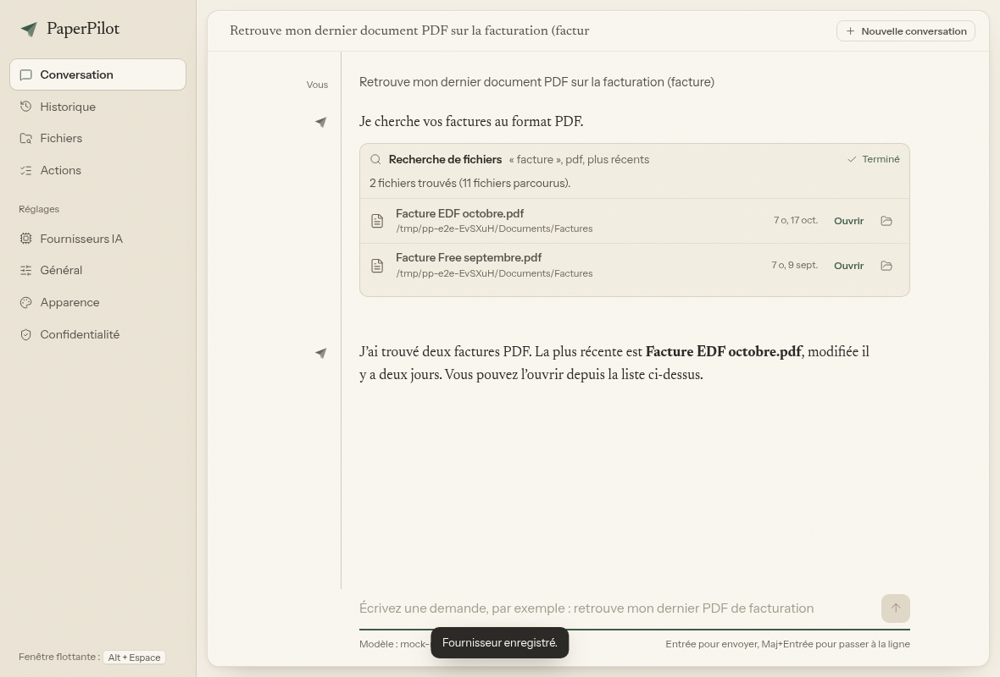
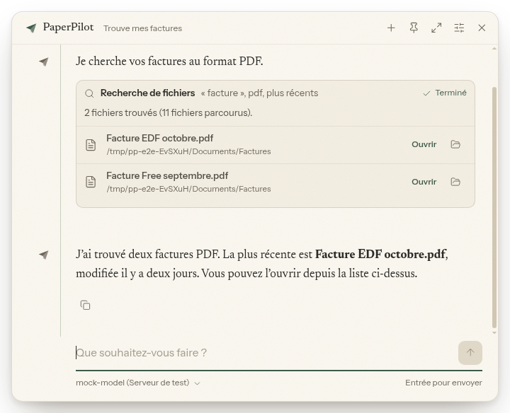
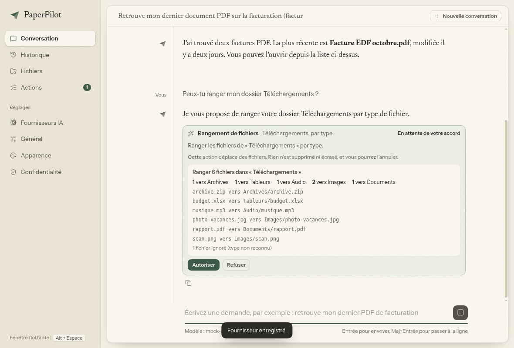

# PaperPilot AI

Assistant IA personnel pour **Kubuntu / KDE Plasma** : discuter avec un modèle, retrouver des fichiers et lancer des actions, depuis une **fenêtre flottante** (raccourci global, `Alt + Espace` par défaut) ou une **application complète** dans le menu des applications.

Interface pensée comme un carnet : fond ivoire, page blanc cassé, vert sauge, serif éditoriale (Newsreader) et sans-serif d'interface (Instrument Sans), polices embarquées et fonctionnement 100 % hors-ligne côté interface.



| Fenêtre flottante | Confirmation d'une action |
|---|---|
|  |  |

*(captures réelles prises par `npm run test:e2e`)*

## Ce qui fonctionne

| Domaine | Détail |
|---|---|
| Fenêtre flottante | Sans cadre, toujours au premier plan, ouverte par raccourci global configurable. Échap annule une génération en cours, puis ferme. Épingle pour la garder ouverte. |
| Application complète | Conversation, Historique, Fichiers, Actions, Fournisseurs IA, Général, Apparence, Confidentialité. |
| État partagé | Un seul processus possède les données : les deux fenêtres affichent les mêmes réglages, fournisseurs, conversations et actions, en direct. |
| Fournisseurs | OpenAI, Anthropic, OpenRouter, Mistral, Groq, Ollama (local) et tout serveur au format OpenAI (LM Studio, vLLM, LiteLLM…). Réponses en flux, annulation, erreurs expliquées en français. |
| Test de connexion | Un vrai appel (liste des modèles puis génération minimale). Jamais de succès simulé. |
| Clés API | Chiffrées via le trousseau du système (KWallet / libsecret) grâce à `safeStorage`, jamais renvoyées aux fenêtres, jamais réaffichées en entier. Le niveau de protection réel est annoncé. |
| Recherche de fichiers | Par nom (accents, pluriels, type, date, tri), dans les dossiers autorisés. Résultats : ouvrir, afficher dans le dossier, navigation clavier. |
| Actions | Catalogue fermé : rechercher, lister, lire un document, ouvrir fichier / dossier / URL / application, afficher dans le dossier, ranger, déplacer, renommer, mettre à la corbeille. |
| Sécurité | Voir [docs/ARCHITECTURE.md](docs/ARCHITECTURE.md). Aucun shell, aucune commande fournie par le modèle, chemins confinés aux dossiers autorisés, confirmation avec aperçu pour toute modification, annulation des déplacements. |
| Historique | Conversations et actions conservées localement, recherche, suppression, export, purge automatique. |

## Démarrage rapide

```bash
sudo apt install nodejs npm        # Node.js 20 ou plus récent
npm install
npm start
```

Installation complète, raccourci KDE/Wayland, compilation du `.deb` et de l'AppImage : **[docs/INSTALL-KUBUNTU.md](docs/INSTALL-KUBUNTU.md)**.

## Commandes utiles

```bash
npm start            # lance l'application
npm test             # 55 tests (actions, sécurité des chemins, fournisseurs, stockage, agent)
npm run test:e2e     # test de bout en bout de la vraie interface (Electron sous Xvfb) + captures
npm run dist         # construit AppImage et .deb dans dist/
paperpilot-ai --toggle      # bascule la fenêtre flottante (pour un raccourci KDE)
paperpilot-ai --settings    # ouvre les paramètres
paperpilot-ai --background  # démarre sans fenêtre
```

## État du projet : ce qui a été vérifié, et ce qui ne l'a pas été

Vérifié automatiquement (voir `test/` et `scripts/e2e.js`) :

- la sécurité des chemins (dossiers autorisés, liens symboliques, `..`, scripts exécutables), les confirmations, le rangement avec aperçu, la non-écrasement et l'annulation ;
- les trois formats d'API (OpenAI, Anthropic, Ollama) : flux, annulation, erreurs HTTP et réseau, test de connexion, contre de **faux serveurs locaux** qui reproduisent ces formats ;
- le parcours complet dans la vraie interface : configuration d'un fournisseur, conversation, recherche, confirmation, annulation, fenêtre flottante, historique partagé ;
- la construction de l'AppImage et du `.deb`, et le lancement du binaire empaqueté (instance unique, `--toggle`).

**Non vérifié faute d'environnement** (à contrôler sur votre machine) :

- un vrai bureau Kubuntu / Plasma : le comportement du raccourci global (X11 : `globalShortcut` ; Wayland : portail `GlobalShortcuts`, dont la prise en charge dépend de votre version de Plasma), le « toujours au premier plan » sous Wayland, la zone de notification, l'apparence réelle de la transparence de la fenêtre flottante ;
- les vrais services OpenAI, Anthropic, OpenRouter, Mistral et Groq : seuls leurs formats ont été testés. Les noms de modèles ne sont volontairement pas imposés : saisissez ceux de votre compte (le bouton « Charger la liste » interroge le fournisseur) ;
- le chiffrement par KWallet : le code l'utilise via Electron, mais n'a pas pu être exercé sans trousseau.

Limites connues : recherche par nom uniquement (la recherche dans le contenu et la recherche sémantique sont prévues par l'architecture, pas implémentées) ; lecture de documents limitée au texte, PDF (`pdftotext`), `.docx` et LibreOffice ; pas de mode sombre ; interface en français uniquement.

## Licence

Code : MIT. Polices Newsreader et Instrument Sans : SIL OFL. Icônes : Lucide (ISC). Les licences sont dans `src/renderer/assets/fonts/`.
